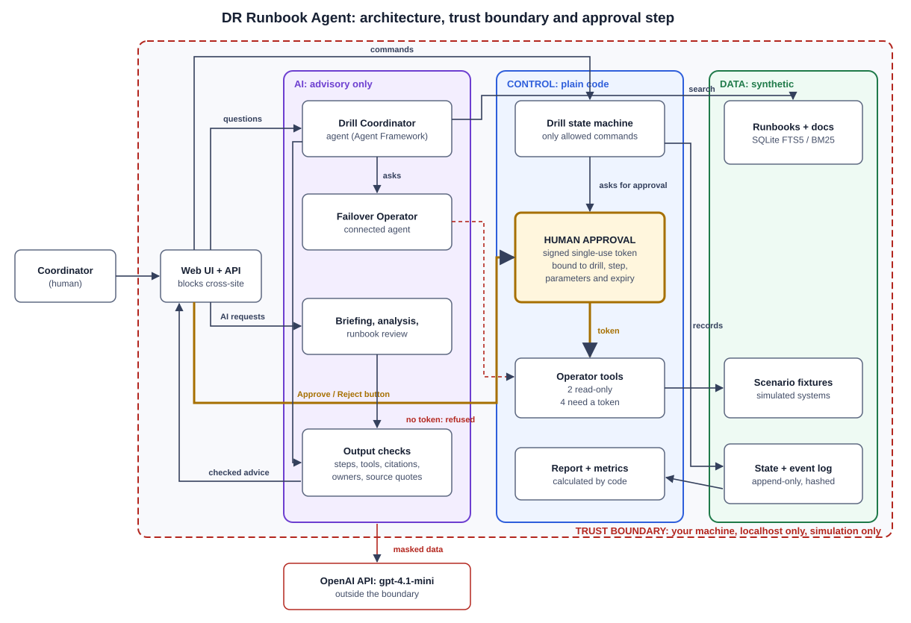
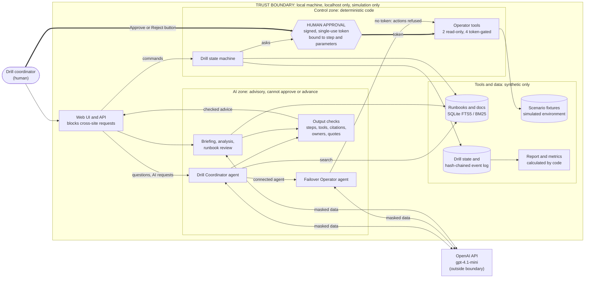
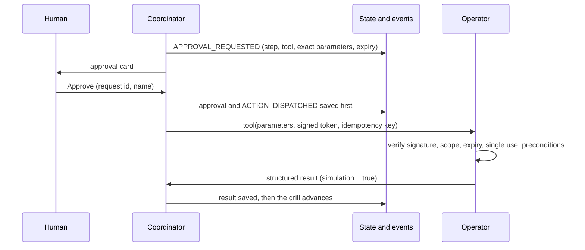

# Architecture

Diagram source

The key design rule: **the model can talk about the drill but cannot drive it.** Control goes from a human
button to the state machine to the operator. The two Agent Framework agents sit beside that path.

## Approval sequence

If the process dies between dispatch and result, the drill reopens with one option, **Reconcile**. It reads the
operator's ledger. It never sends the action again.

## Components

| File | Responsibility |
|---|---|
| `drill/coordinator.py` | Lifecycle, command gate, approvals, retry, rollback, pause and resume |
| `drill/operator.py` | Six-tool registry, scenario fixtures, token verification, idempotency |
| `drill/security.py` | HMAC approval tokens, secret masking |
| `drill/store.py` | `get_drill_state`, `save_drill_state`, `log_event`, `get_events` |
| `drill/knowledge.py` | Runbook validation, cited search |
| `drill/report.py` | RTO, RPO, tier metrics, approval audit, Markdown report |
| `drill/agents.py` | The two agents, their tools, loop limits, answer guard |
| `drill/insights.py` | Step briefing, post-drill analysis, runbook interpretation, and their output checks |
| `drill/web.py` | HTTP API, localhost and cross-site protection |

## Why these choices

- **SQLite** for state, events and search: one local file, transactions, no service to provision.
- **One command gate:** `controls()` lists what is allowed now, and the UI shows only that. Every guard against
  skipping ahead lives in one place.
- **Failure policy is data:** retry limits, failure branches and rollback text live in the runbook, with a hard
  cap of three retries in code.
- **Model limits:** four tool-loop iterations and eight function calls per agent run.
