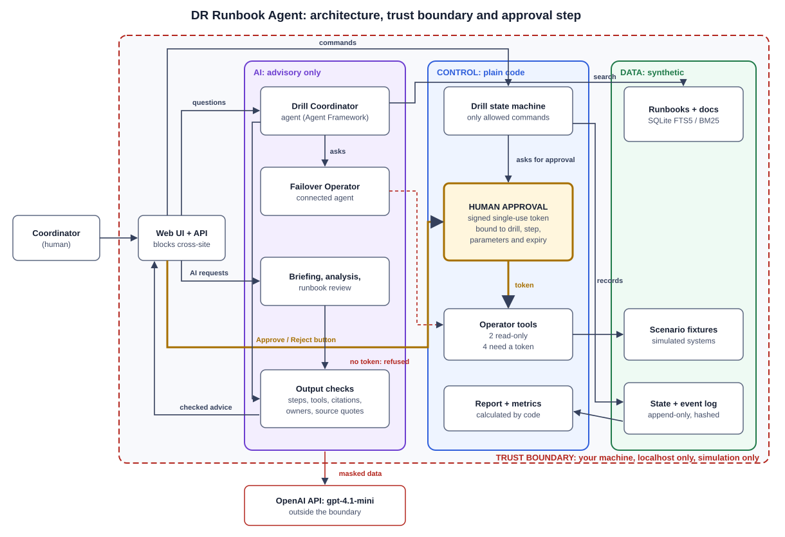

# Architecture

## Components
| Component (in `src/`) | Responsibility | Connects to |
|---|---|---|
| `web/` browser UI | Drill chat, portal, trace, evaluation. Holds no key | Local API |
| `drill/web.py` | Local API on `127.0.0.1:8088`; blocks cross-site requests | Core and agents |
| `drill/coordinator.py` | State machine: sequence, approvals, retry, rollback, pause/resume | Operator, store, knowledge |
| `drill/operator.py` | Allow-listed simulated tools, token and idempotency checks | Scenario files |
| `drill/agents.py`, `drill/insights.py` | The two agents, structured AI features, output checks | OpenAI API |
| `drill/security.py`, `drill/store.py` | Signed tokens, masking; versioned state, hash-chained event log (SQLite) | - |
| `drill/knowledge.py`, `drill/report.py` | Runbook validation, cited search; metrics and report | `sample_data/knowledge/` |

## Agent workflow
1. A question goes to the **Drill Coordinator agent**, which reads drill state and events, searches approved
   sources and may ask the connected **Failover Operator agent** to run a read-only check.
2. Agent output is checked for unknown step IDs, tool names and citations before it is shown.
3. **The agents cannot drive the drill.** Human commands go to the state machine. For an action:
   approval request, then human **Approve**, then a signed single-use token (bound to drill, step, tool,
   parameters and expiry), then the Operator tool, then the saved result, then the next step.
4. A state-changing tool called without that token returns `REJECTED_UNAUTHORIZED` and is logged.
5. If a dispatch is interrupted or its result is unknown, the only option is to reconcile. It is never resent.

## Models and tools
- **Model:** OpenAI `gpt-4.1-mini` for all AI features. Timing, metrics, rules and control use no model.
- **Coordinator tools:** `get_drill_state`, `get_events`, `search_runbook`, `ask_failover_operator`.
- **Operator tools:** `check_replication`, `check_health` (read-only); `failover_database`,
  `repoint_application`, `update_dns`, `rollback_step` (token required).
- **Libraries:** Microsoft Agent Framework, Foundry Responses host, Starlette, Uvicorn, Pydantic, SQLite FTS5.
- **Limits:** 900 output tokens, 4 tool-loop iterations, 8 tool calls, 45 s per call, 60 AI calls per drill,
  3 retries per step.

## External services
- **OpenAI API only**, called from the local backend. It receives masked drill context, questions, passages and any
  pasted runbook text, with response storage switched off in each request.
- No Azure resources, managed search or infrastructure systems. All data is synthetic.
